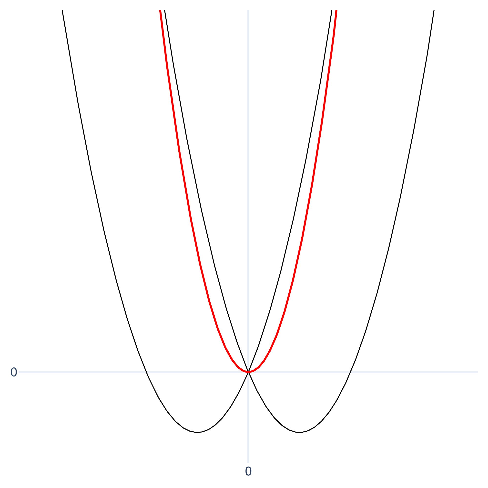
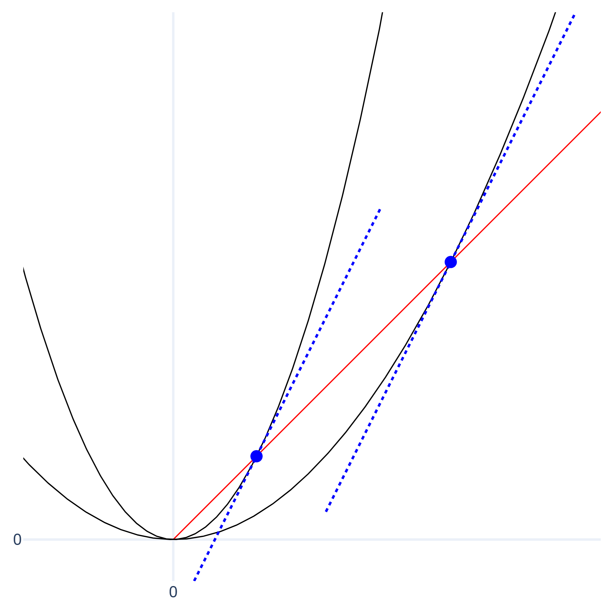

# 勾配ブースティング(GBDT)をイメージで理解する 仕組み編  
  
この記事では、XGBoostやLightGBMのコアとなる考え方を、直感的なイメージを優先してできるだけわかりやすく解説します。  
冒頭の「GBDTのつくり」は、最初からすべて理解しようとする必要はありません。まずはざっと目を通すだけで大丈夫です。  
続く「全体像」のパートにGBDTの考え方のエッセンスをまとめてあります。より深い仕組みを知りたい場合は、必要に応じて記事内リンクから詳しい解説へ飛べるようになっていますので、辞書的に活用してください。  
  
## GBDTのつくり  
GBDTでは、「損失関数」「最適化手法」「学習器」という3つのスロットを自由に差し替え可能。  
仕組みはシンプル。  
まず損失の与え方を損失関数で設計し、損失を最も減らす更新量を最適化手法で計算し、それを学習器で近似して足し合わせていくだけ。  
各スロットはモジュールのように独立している。  
**損失関数**：基本的に、2階微分可能かつ下に凸であれば自由に設計できる（ニュートン法を使う場合）。  
**最適化手法**：基本の勾配降下法もあるが、高速・高精度なニュートン法（2階微分の利用）が現在の主流。  
**学習器**：線形モデルやニューラルネットも利用可能だが、テーブルデータにおいては決定木がデファクトスタンダード。  
つまり現代の実装において最適化手法と学習器はほぼ固定されており、選定の余地があるのは実質「損失関数」のみ。  
  
## GBDTの全体像  
  
### データの姿と目標  
特徴量空間の中に、たくさんのデータ点が散らばっている。  
各データ点は正解値を持っており、それを予測するのが目的。  
つまり、空間内における各点の配置位置と正解値の関連性を学習する。  
  
### 損失の計算  
予測値`f`と正解値`y`のペアから損失`l`を計算する関数`l = ℓ(f, y)`を用意する。  
この関数`ℓ`はすべてのデータ点に対して同じものが適用されるが、各点の正解値は固定なので、実質的には各点が「予測値を入力すると損失が出力される独自の線グラフ`l = ℓ(f)`」を持っていると見なせる。  
関数`ℓ`は、この線グラフが下に凸の曲線になるように設計する(横軸を予測値、縦軸を損失としたとき)。  
最終的な目的は、すべてのデータ点の損失`l`を足し合わせた「全体の損失」を最小化すること。  
この全体の損失`L`を求める式`L = Σ_i ℓ(f_i, y_i)`がGBDTにおける損失関数となる。  
[損失関数とは何か](#損失関数とは何か（損失の計算）)  
[損失関数の基本形](#損失関数の基本形（損失の計算）)  
[損失関数の幾何学的イメージ](#損失関数の幾何学的イメージ（損失の計算）)  
[損失関数の設計](#損失関数の設計（損失の計算）)  
  
  
### 学習の流れ  
#### 初期化  
まず、すべてのデータ点に同じ予測値（初期値）を設定する。  
[初期予測値の決定](#初期予測値の決定（初期化）)  
  
#### ステップ1：曲線の近似  
各データ点の損失曲線を、現在の予測値の位置を基準に2次放物線で近似する。  
これは、予測値をどの方向にどれだけ更新すれば最も効率よく損失を減らせるかを見積もるため。  
この時点で、各データ点は自分専用の近似放物線を持っている状態になる。  
[ニュートンステップ](#ニュートンステップ（ステップ1：曲線の近似）)  
[各データ点の状況](#各データ点の状況（ステップ1：曲線の近似）)  
  
#### ステップ2：決定木の作成  
次に、浅い決定木を作成する。  
この木の役割は次の2つ。  
* データ点を、似た特性を持つグループに分けるように分割する。  
* 分割後の各グループに対して、損失を最も効率よく減らせる更新量を出力する。  
  
この分割位置と出力値の決定に、近似放物線の情報が使われる。  
これはGBDT特有のアプローチ。  
[回帰と二値分類の違いについて](#回帰と二値分類の違いについて（ステップ2：決定木の作成）)  
[特別な決定木](#特別な決定木（ステップ2：決定木の作成）)  
[決定木がやっていること](#決定木がやっていること（ステップ2：決定木の作成）)  
[過学習を防ぐ](#過学習を防ぐ（ステップ2：決定木の作成）)  
[更新量の決定](#更新量の決定（ステップ2：決定木の作成）)  
  
#### ステップ3：予測値の更新  
作成した決定木の出力に学習率を掛けた値を、各データ点の現在の予測値に足して更新する。  
  
#### ステップ1～3の繰り返し  
更新後の新しい予測値を基準に、再び近似放物線を作り直す。  
その後、新しい決定木を作り、予測値を更新する。  
この流れを、設定した回数に達するか、損失の改善が十分に見られなくなるまで繰り返す。  
  
### 完成したモデル  
最終的なモデルは、次の2つの組み合わせで表現される。  
* 初期予測値  
* 学習によって作られた多数の決定木(※出力は学習率で調整される)  
  
[最終的な予測モデルの姿](#最終的な予測モデルの姿（完成したモデル）)  
  
### 予測の実行  
新しいデータを予測するときは、次の処理を行う。  
1. 特徴量空間の中に予測したいデータ点を配置する。  
1. 学習で作られたすべての決定木を適用し、「初期予測値」と「各決定木の出力」をすべて足し合わせる。  
  
この合計値が最終的な予測値となる。  
  
## 解説  
### 損失関数とは何か（損失の計算）  
損失関数とは、ビジネス上のドメインロジックを数式に翻訳したもの。  
「何を達成したいか？」「どういう間違え方が一番ダメで、どういう間違え方なら許容できるか？」という価値観そのものと言える。  
ここを変えるだけで、モデルは「売上予測機」にも「スパム判定機」にもなる。  
実装の上では「正解値と予測値の誤差に対して、どのような性質のペナルティ(損失)を与えるか」を定義することであり、モデルはそのペナルティの総和を最小化する計算機に過ぎない。  
  
[戻る](#損失の計算)  
  
### 損失関数の基本形（損失の計算）  
**数式**  
`L = Σ_i ℓ(f_i, y_i)`  
**数式の構成要素**  
`L`：最終的な総損失  
`ℓ`：損失の定義（各データに対する損失を計算する関数）  
`f_i`：データ`i`における予測値  
`y_i`：データ`i`における正解値  
  
[戻る](#損失の計算)  
  
### 損失関数の幾何学的イメージ（損失の計算）  
基本構造  
・学習に使う全データ`i = 1, 2, ..., n`それぞれに対して、完全に独立した2次元平面が存在する。  
・各平面は「そのデータ専用の予測値軸`f_i`」と「損失軸」で構成される。  
・各平面上に「下に凸な曲線グラフ」が一つずつ描かれている。  
・この曲線は予測値`f_i`を受け取り、損失値`ℓ(f_i, y_i)`を返す関数のグラフである。  
・各データの正解値`y_i`が異なるため、曲線の最小値の位置も異なる。  
・これらn個の平面は幾何学的に別物であり、互いに干渉しない。  
総損失の計算  
・各平面上の曲線が出力した損失値をすべて足し合わせた値が総損失`L`となる。  
・これが損失関数の式`L = Σ_i ℓ(f_i, y_i)`の意味。  
  
[戻る](#損失の計算)  
  
### 損失関数の設計（損失の計算）  
損失関数は自由に設計できるが、ニュートン法を扱うには以下の条件を満たす必要がある。  
1. 2階微分可能であること（勾配`g`と曲率`h`を計算するため）  
1. グラフが下に凸であること（厳密には、常に`h > 0`であること。これにより、どの予測値から始めても必ず谷底にたどり着ける）  
  
#### オーソドックスな損失関数は以下の2つ(`f`は予測値、`y`は正解値)  
  
**二乗誤差(回帰用)**  
損失の定義：`ℓ(f, y) = 1/2 (f - y)^2`  
※微分した形を簡単にするため`1/2`を掛けることが多い。  
損失関数は`L = Σ_i 1/2 (f_i - y_i)^2`となる。  
  
**対数損失(二値分類用)**  
損失の定義：`ℓ(f, y) = - y log(σ(f)) - (1 - y) log(1 - σ(f))`  
※`f`は対数オッズ。損失計算ではシグモイド関数`σ(f)`で確率に変換して使う。  
損失関数は`L = Σ_i (- y_i log(σ(f_i)) - (1 - y_i) log(1 - σ(f_i)))`となる。  
  
これらは回帰と分類における最も基本的な損失関数であり、ほとんどのケースに対応できる。  
特殊なビジネス要件においては、これらをカスタムして使うこともある。  
例えば過小評価をより重く罰する非対称な損失など。  
  
[戻る](#損失の計算)  
  
### 初期予測値の決定（初期化）  
まず最初に、予測の出発点となる初期値を決める。  
ここではすべてのデータに対して同じ値を当てはめることを考える。  
そしてそのときに損失の合計が最も小さくなる定数を探す。  
その値が最初の予測値となる。  
通常、回帰の場合は全正解値の平均となり、二値分類(クラス0/クラス1を分類)の場合はクラス1の割合の対数オッズとなる※例えばデータが100個あって、1が70個、0が30個だった場合、クラス1の割合0.7の対数オッズ(約0.847)。  
この最初の予測値を全データに適用し、そこからの理想的な更新量を出力する決定木を作る。  
  
[戻る](#初期化)  
  
### ニュートンステップ（ステップ1：曲線の近似）  
損失曲線上で、「予測値を次にどれくらい更新すれば最も損失を減らせるか」の目安が欲しい。  
しかし、実際の損失曲線は複雑で計算が難しいため、「現在自分がいる点が、もしシンプルな放物線（二次関数）の上だったとしたら、それはどんな形の放物線か？」を考えて近似する。つまり現在地における高さ・傾き・曲率がピッタリ一致する放物線を作る(これを二次のテイラー展開と呼ぶ)。  
  
ここでは現在地からの更新量`w`を用いて、近似放物線を`a w^2 + b w + c`と表す。  
現在地（更新量`w = 0`の地点）における情報を3つ（高さ`L`、傾き`g`、曲率`h`）持っているので、これらを使って係数合わせを行う。  
  
* 近似放物線において  
    * 現在地の高さは、近似式`a w^2 + b w + c`に`w = 0`を代入して`c`となる。これが`L`に等しい(`c = L`)。  
    * 現在地の勾配は、1階導関数`2 a w + b`に`w = 0`を代入して`b`となる。これが`g`に等しい(`b = g`)。  
    * 現在地の曲率は、2階導関数`2 a`(定数)となる。これが`h`に等しい。つまり`a = 1/2 h`。  
  
これらを代入すると近似式は`1/2 h w^2 + g w + L`となる。  
ただし、ここで考えるのは「現時点からどのくらい損失を減らせるか」のみなので、現時点での損失`L`は考慮する必要がない。  
したがって、最終的な近似式(放物線)は`1/2 h w^2 + g w`となる。  
  
この放物線は谷底で最小値をとるので、その位置までの更新量`w`を求める。  
谷底では傾きが0になるため、式を`w`で微分して`0`とおくと`h w + g = 0`  
つまり`w = - g / h`  
この`w`が「近似した放物線における最も損失が減る更新量」であり「真の損失関数における更新量の最適な目安」となる。  
これをニュートンステップと呼ぶ。  
  
ちなみに、ニュートンステップ `- g / h` の意味を別の角度から捉えると、曲率 `h` の重要な役割が見えてくる。  
まず、曲率`h`が大きいということは谷が急であることを意味するので、少し進んだだけで損失が急激に下がる一方、行き過ぎると反対側の坂を登ってしまう危険がある。  
だが`w = - g / h`では曲率`h`が分母にあるため、`h`が大きいほど更新量`w`は小さく抑えられることがわかる。  
つまり曲率`h`は各データ点の地形の険しさを測り、それに応じて最適な歩幅を自動調整する賢いブレーキとして機能している。  
この自動調整ブレーキの仕組みにより、ニュートン法は単純な勾配降下法よりも効率的に、しかも安全に最適解に近づくことができる。  
  
[戻る](#ステップ1：曲線の近似)  
  
### 各データ点の状況（ステップ1：曲線の近似）  
特徴量空間の中に各データ点`i`があり、全ての`i`は独自の正解値`y_i`とその時点での予測値`f_i`を持っている。  
各データ`i`の損失曲線をテイラー展開（2次近似）し、全ての`i`が「自分専用の小さな近似放物線」を持っている様子をイメージする。  
これらの放物線はそれぞれの`i`専用の予測値空間(2次元平面)内にある。  
近似した二次関数は現在地からの更新量`w`と損失の変化`l`を用いて   
`l = 1/2 h w^2 + g w`と表せる。  
これらの放物線を決定木で分割しながら、全体の損失を最大限減らすことができる理想的な更新量を探っていく。  
  
[戻る](#ステップ1：曲線の近似)  
  
### 回帰と二値分類の違いについて（ステップ2：決定木の作成）  
回帰でも二値分類でも予測には回帰木を使用し、各データの予測値を少しずつ更新していくというアプローチをとる。  
ただ二値分類の場合は予測値が確率であり、そのままでは足し合わせることができない(確率は0から1の範囲に収まる必要があるため、そのまま足し合わせると範囲を突き抜けてしまう)。  
そこで、その確率を対数オッズに変換したものを疑似的な予測値として扱う。  
最終的に最適な予測値(対数オッズ)を求めたら、それをシグモイド関数で再変換して確率に戻す。  
  
[戻る](#ステップ2：決定木の作成)  
  
### 特別な決定木（ステップ2：決定木の作成）  
GBDTにおいて、決定木が放物線を2グループに分ける基準はとてもユニークで合理的。  
まず、分割対象の葉に含まれる放物線をすべて合算し、1つの巨大な放物線を作る。  
そしてその谷底の深さ(現在地からの損失減少)を求める。   
次に葉を2つに分割し、それぞれのグループ内で放物線を合算する。すると巨大な放物線が2つできる。 この2つの谷底の深さの合計が、最も深くなる分割を探す。  
最善の分割が見つかったら、「分割後の損失減少の合計」と「分割前の損失減少」の差を求める。この差分はGain(利得)と呼ばれ、分割によってどれだけ余分に深く掘れたかを表す。もしGainが小さすぎる場合は、木を複雑にするコストに見合わないと判断して分割を行わない。  
この分割基準は従来の決定木のものとは本質的に異なる。  
GBDTの木は、どれだけ直接損失を減らせるかという純粋な基準で成長する。  
言わば、GBDTのために特別に設計された決定木。  
  
[戻る](#ステップ2：決定木の作成)  
  
### 決定木がやっていること（ステップ2：決定木の作成）  
具体的に「最善の分割」や「更新値」はどうやって計算されるのか？その仕組みを紐解いてみる。  
まず分割した2つの葉それぞれにひとつずつ最適な更新量を求める。  
最適な更新量とは、同じ葉に含まれる全放物線の損失変化の和`Σ_i l_i`を最小にできる値である。  
データ`i`における損失変化`l_i`を`1/2 h_i w^2 + g_i w`とすると、`Σ_i l_i`は`Σ_i (1/2 h_i w^2 + g_i w)`と表せる。  
この式は「個別の放物線`1/2 h w^2 + g w`をすべて足し合わせた1つの巨大な放物線」と見ることができる。  
分かりやすく`1/2 Σ_i h_i w^2 + Σ_i g_i w`と変形し、`G = Σ_i g_i`、`​H = Σ_i h_i`とおくと`1/2 H w^2 + G w`。  
つまり`Σ_i l_i`はこの巨大放物線の値そのものであり、その値が最小になる更新値`w`とはまさにこの巨大放物線のニュートンステップ`w = - G / H`である。  
`w = - G / H`を巨大放物線`1/2 H w^2 + G w`に代入し、`Σ_i l_i`の最小値を求める。  
`1/2 H (- G / H)^2 + G (- G / H)`  
`= 1/2 G^2 / H - G^2 / H`  
`= - 1/2 G^2 / H`  
この最小値を見ると`G^2 / H`の値が大きいほど損失がたくさん減ることが分かるので、できるだけ`G^2`の値を大きく、`H`の値を小さくできるような分割が最善ということになる。  
  
#### まず`G^2`の値を最大化するため、`G`の絶対値を大きくする。  
2つの葉それぞれの`G = Σ_i g_i`の絶対値を大きくするとはつまり、`g`をできるだけ「プラスチーム」と「マイナスチーム」がきれいに分かれるように2分割したいということ。  
`g`の合計が相殺されないように分ける。  
  
この相殺を幾何学的なイメージで捉えてみる。  
`g`がプラスの放物線は、谷底が現在地より左側にある。  
逆に`g`がマイナスの放物線は、谷底が現在地より右側にある。  
その2つの放物線を現在地を基準にして重ね合わせた時、片方のグラフが谷底になる地点では、もう片方のグラフは現在地の基準線0よりも高い位置（プラスの領域）にある。  
そのため、この2つの放物線を足し合わせると、互いの谷底の深さを打ち消し合うように全体が持ち上げられ、合体後の谷底は浅くなってしまう。  
これはつまり、損失を減らす力が相殺されてしまったということを意味する。  
  
  
#### そしてHの値は小さくしたい。  
`h > 0`となる損失関数を選択しているので、`H > 0`。  
`1 / H`という反比例のグラフの性質を考えると、分母の`H`が小さくなればなるほど値は急激に増えるため、全体からできるだけ少数の精鋭（`h`が小さい集団）を切り出す2分割をしたいということになる。  
ただし、単にデータ数を減らして`H`を小さくしても、同時に`G`も消えてしまっては意味がない。  
あくまで`G`は保ったまま、`H`だけが小さいという、効率よく損失を減らせる場所を見つけ出すのが目的。  
  
ここで「勾配`g`が同じとき、曲率 `h`が小さいほど谷底までは深くなる」という性質を幾何学的なイメージで捉えてみる。  
直感的には分かりにくいかもしれないが、核心となるイメージは「坂が緩やかなほど、より高い位置にならなければ勾配は大きくならない」というもの。  
ここでは分かりやすいように、放物線 `y = 1/2 h w^2` の右側(`w > 0`)の坂を使って考える（左側でも理屈は同じ）。  
曲線上で適当な点を選び、原点からその点へ直線を引く。  
このとき、引いた直線の傾きは選んだ点での接線の傾き(勾配)`g`の半分`1/2 g`になる。  
※これは以下の2つの傾きの比を見れば明らか  
原点から引いた直線の傾き： `y / w = 1/2 h w`  
選んだ点での接線の傾き： `g = dy / dw = h w`  
  
引いた直線はグラフ上で`y = 1/2 g w` と表せる。  
これは、放物線の曲率`h`の値に関わらず、同じ勾配`g`を持つ点へ引く直線は全て同じものになるということ(つまり`g`が同じ点は一直線上に並ぶ)。  
`w > 0`,`h > 0`なので`g > 0`、つまりこの直線は右上がり。  
曲率`h`が小さい緩やかな放物線ほど、この直線と交わる点の位置が右上になるので、同じ`g`を持つ点の`w`(距離)と`y`(高さ、つまり損失の減少量)は大きくなる。  
  

  
次に曲率の制限について考える。  
極端に曲率が小さいと損失は爆発的に減少するが、そういったケースはたまたまの外れ値である可能性が高く、そこに過剰に合わせに行くことは典型的な過学習の原因になる。  
そこで、以下の2つの対策をとる。  
1.「`H`が小さすぎる分割」を禁止するために`H`の最小値をパラメータで定めておく。  
2.巨大放物線`1/2 H w^2 + G w`にL2正則化項`1/2 λ w^2`を追加で足し合わせる(λは正則化パラメータ)。  
数式では`1/2 H w^2 + G w + 1/2 λ w^2 = 1/2 (H + λ) w^2 + G w`。  
最小値は`- 1/2 G^2 / (H + λ)`となる。  
分母に正則化パラメータが加わることで分母が0に近づくのを防げるため、計算結果が爆発するのを回避できる。  
幾何学的イメージでは、「極端に深く大きくなってしまった巨大放物線」に「現在地を頂点とするL2正則化放物線」を二次関数的な急ブレーキ役として足し合わせ、極端な更新量を現在地方向に強く引き戻す。  
※学習率でも「更新量を一律で0.1倍にする」ような線形のブレーキをかけるが、更新量が無限大や1兆になってしまったら、0.1倍してもまだデカすぎて制御不能になる。  
L2正則化は分母に`+λ`することで、そもそも更新量が異常な値になることを構造的に防ぐブレーキ。  
  
[戻る](#ステップ2：決定木の作成)  
  
### 過学習を防ぐ（ステップ2：決定木の作成）  
#### 木の深さ  
1本1本の木は浅く保つようにする。  
木を深くしすぎると、細かいデータまで正確に分けすぎてしまうため。  
あえて浅くして解像度を下げることで、細部に潜むノイズをぼかし、全体の大まかな特徴（シグナル）だけを捉えられるようにする。  
  
#### 木の強さ  
ニュートンステップは近似手法として優秀すぎるため、対数損失なら数回で最深部にほぼ到達し、二乗誤差なら(損失関数自体がそもそも二次関数なので)一発で底を特定してしまう。  
しかし、正解値という「ある特定のケースの結果」にモデルを過剰に適合させるべきではない。  
なぜなら、正解値には「普遍的なルール(シグナル)」だけでなく「特定のケースにしか発生しない偶然(ノイズ)」も含まれているから。  
そこでノイズまで取り込まないように、1本1本の木の出力(実際の更新量)を意図的に抑える。  
優秀すぎる歩幅にあえてブレーキをかけながら進むイメージ。  
そのために使うブレーキ係数が学習率。基本的に学習率には一定の定数を用いる。  
※ちなみにニュートンステップは予測値`y`の更新量そのものなので、単位は`y`と同じになる。これにより、単純な勾配降下法のように学習率が「単位を合わせる変換係数」の役割を担う必要がない。  
  
#### 木の多さ  
予測値を更新しても精度が向上しないという現象が一定回数続いた場合、そこで学習を打ち切る(Early Stopping)。  
モデルが「意味のある法則」をほとんど学び終えたサインであり、それ以上木を増やし続けると単なる偶然や入力ミスのような「意味のない法則」を無理やり学び始めてしまう。  
※「木の強さ」と「木の多さ」はシーソーの関係にある。学習率で強くブレーキをかけるほどゴールまで進むのにたくさんの木が必要になる。ブレーキを弱めると少ない木でゴールに着いてしまう。一般的に「学習率のブレーキは強くして、その分たっぷりと木の本数を用意し、Early Stoppingで最適な場所で止める」のが、最も精度が出やすい定石。  
  
#### L1正則化  
L1正則化を使うと、効果の薄い葉の出力を完全に0に押しつぶすことでモデルを簡略化できる。  
ただL2正則化に比べると補助的に使われることが多いため、詳細は割愛。  
  
[戻る](#ステップ2：決定木の作成)  
  
### 更新量の決定（ステップ2：決定木の作成）  
分割後、それぞれの葉の中にある巨大放物線のニュートンステップを決定木の出力とする。  
あらかじめ定めておいた木の深さまでこの分割を繰り返し、決定木を完成させる。  
  
[戻る](#ステップ2：決定木の作成)  
  
### 最終的な予測モデルの姿（完成したモデル）  
「初期値」と「学習率で調整された各決定木の出力」を単純にすべて足し合わせたものが最終的な予測値となる。  
**数式**  
`y_hat = F_0 + Σ_m η T_m`  
**数式の構成要素**  
`y_hat`：最終的な予測値。  
`F_0`：初期値（定数）。予測のベースライン。  
`η`：学習率(`0 < η ≦ 1`)。  
`T_m`：各決定木の出力。  
  
[戻る](#完成したモデル)  
